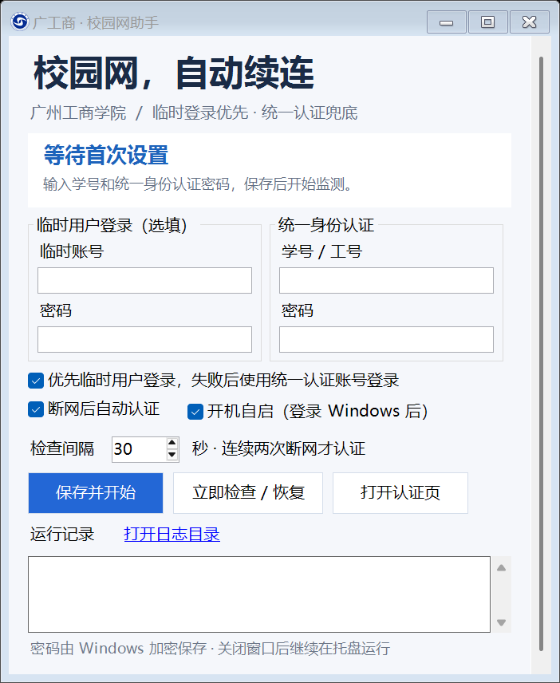

<p align="center">
  
</p>

<h1 align="center">GGS WiFi · 广工商校园网助手</h1>

<p align="center">Windows 校园网自动认证工具：临时登录优先，统一认证兜底。</p>

<p align="center">
  <a href="https://github.com/andows7/ggs-wifi/releases/latest"></a>
  <a href="https://github.com/andows7/ggs-wifi/actions/workflows/ci.yml"></a>
  
  
</p>

个人开发的广州工商学院校园网辅助工具。连接校园 Wi-Fi 或网线后，在断网时调用学校官方门户完成已有账号的正常认证。

## 下载

前往 **[Releases](https://github.com/andows7/ggs-wifi/releases/latest)** 下载最新版本。

| 文件 | 用途 |
| --- | --- |
| `GGS-WiFi-v1.2.0-windows-x64.exe` | 单文件便携程序，下载后直接运行 |
| `GGS-WiFi-v1.2.0-windows-x64.zip` | 相同程序及使用文档 |
| `SHA256SUMS.txt` | EXE 与 ZIP 的 SHA-256 校验值 |

运行环境：**64 位 Windows 10 / 11、.NET Framework 4.8，以及 Edge 或 Chrome**。无需安装 Python、Node.js 或 NuGet 依赖。发行程序未进行代码签名。

## 功能

- **两套独立凭据**：临时登录与统一认证分别填写、分别加密保存。
- **自动切换**：优先尝试临时登录，未能恢复联网时改用统一身份认证。
- **自动续连**：默认每 30 秒检测一次网络，自动检查连续两次失败后认证；手动检查立即执行。
- **后台运行**：关闭窗口后保留在系统托盘，支持登录 Windows 后自动启动。
- **密码保护**：使用 Windows DPAPI，仅原电脑的原 Windows 用户可解密。
- **结果验证**：认证后检查互联网连通性，避免仅凭成功页文字误报。
- **运行日志**：记录认证阶段及脱敏错误；验证码或额外确认需要手动处理时暂停重试。

## 快速开始

1. 将 EXE 放到固定目录，连接校园 Wi-Fi 或网线后运行。
2. 在右侧「统一身份认证」填写学号 / 工号及对应密码。
3. 如需临时登录，在左侧填写**另一套临时账号和密码**，保留「优先临时用户登录」选项。
4. 根据需要勾选「断网后自动认证」「开机自启」，点击 **保存并开始**。
5. 关闭窗口后程序继续在托盘运行；右键托盘图标可检查、暂停 / 恢复或退出。

临时账号与密码同时留空，或取消临时登录优先选项时，直接使用统一认证。修改账号、密码或登录方式后需重新保存。

<p align="center">
  
</p>

### 更新与卸载

- **更新**：先从托盘菜单退出旧版，再替换程序。账号配置保留；运行新版后点击「保存并开始」，同步更新自启路径。
- **取消自启**：取消「开机自启」并保存。
- **卸载**：取消自启并退出后删除 EXE；如需清除凭据与会话，再删除 `%LOCALAPPDATA%\GGS_WIFI`。

## 常见问题

### 提示需要验证码或二次验证

到学校官方认证页完成验证，再点击「立即检查 / 恢复」。程序不会自动求解验证码；短信登录选项、验证说明或隐藏控件本身不会触发暂停。

### 提示接入参数无效 / 非法接入

确认已连接校园网，使用「打开认证页」取得当前入口。程序会校验当前网卡 IP，避免复用旧链接中的 IP、MAC 或 VLAN。TUN / VPN 用户需确保校内网关与学校认证服务能够直连。

### 已认证仍提示无法联网

程序使用内容严格匹配的标准 HTTP 检测页及 HTTPS 备用检测页。若门户成功但检测仍失败，可查看运行日志；校园网上游故障、账号状态或网络策略仍需在学校侧处理。

### 配置和日志在哪里

点击界面的「打开日志目录」，或打开 `%LOCALAPPDATA%\GGS_WIFI`。

| 项目 | 内容 |
| --- | --- |
| `settings.json` | 两组账号、加密密码及选项 |
| `activity.log` / `.1` | 滚动运行日志 |
| `BrowserProfile` | 专用后台浏览器会话 |

不要将配置文件、浏览器会话、密码或完整认证链接上传到 Issue。运行日志不记录密码和原始认证请求。更多配置和工作方式见 **[详细使用说明](docs/USAGE.md)**。

## 从源码构建

使用 Windows 自带 .NET Framework C# 编译器，不下载 NuGet 包。

```powershell
git clone https://github.com/andows7/ggs-wifi.git
cd ggs-wifi
powershell -NoProfile -ExecutionPolicy Bypass -File .\build.ps1
```

默认输出 `outputs\GGS-WiFi.exe`，目标架构为 x64。可传入 `-Architecture x86` 或 `-Architecture anycpu` 构建其他架构，使用 `-OutputName` 自定义文件名。

```powershell
# 离线回归测试；需要本机安装 Edge 或 Chrome
powershell -NoProfile -ExecutionPolicy Bypass -File .\test.ps1

# 构建版本化 EXE、ZIP 和 SHA256SUMS.txt
powershell -NoProfile -ExecutionPolicy Bypass -File .\scripts\package-release.ps1
```

默认回归测试使用本地网页、模拟响应和测试凭据，不向学校提交登录，不更改 Windows 自启项。GitHub Actions 在 Windows 上执行相同检查。

## 项目结构

```text
src/                      应用、门户参数、浏览器认证与自动切换
assets/                   透明 PNG、Windows 多尺寸 ICO 与资源说明
docs/                     界面截图与详细使用说明
tests/                    离线回归测试及网页样本
scripts/package-release.ps1  生成发行包与校验值
.github/workflows/ci.yml   Windows 构建与测试
build.ps1                 编译便携 EXE
test.ps1                  编译并执行测试
```

## 反馈与贡献

通过 **[Issues](https://github.com/andows7/ggs-wifi/issues)** 报告问题，附 Windows 版本、程序版本、登录方式、复现步骤及脱敏日志。欢迎提交 Pull Request；说明修改目的并运行 `test.ps1`。

版本变化见 **[CHANGELOG](CHANGELOG.md)**。发布标签使用 `vMAJOR.MINOR.PATCH`，二进制名称包含应用名、版本、系统与架构。

## 资源与授权

校徽由用户提供，相关标识权利归广州工商学院或相应权利人；本项目为个人工具，不代表学校官方发布。源码尚未另行指定开源许可证。测试网页、jQuery 等第三方资源的来源及授权说明见 **[THIRD_PARTY_NOTICES](THIRD_PARTY_NOTICES.md)**。
